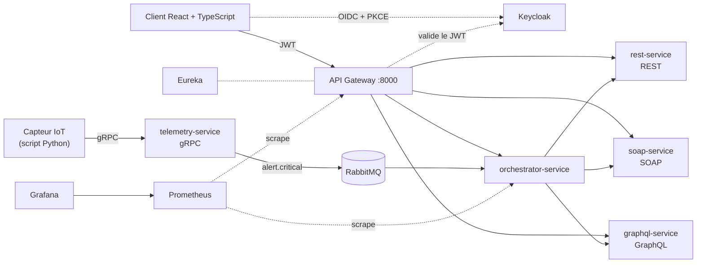
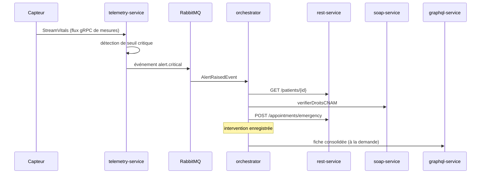

# Smart Healthcare : plateforme d'hôpital connecté


Plateforme de microservices pour un hôpital connecté et le suivi de santé à domicile.
Quatre services utilisant quatre protocoles différents (SOAP, REST, GraphQL, gRPC) sont
exposés derrière une API Gateway, sécurisés par Keycloak et orchestrés par des événements RabbitMQ.

Projet académique : Service Oriented Computing, 3e année cycle ingénieur (ENICarthage).
Toutes les données (patients, actes, tarifs, seuils médicaux) sont **fictives**.

## Sommaire

- [Smart Healthcare : plateforme d'hôpital connecté](#smart-healthcare--plateforme-dhôpital-connecté)
  - [Sommaire](#sommaire)
  - [Ce que démontre le projet](#ce-que-démontre-le-projet)
  - [Architecture](#architecture)
  - [Workflow d'une alerte médicale](#workflow-dune-alerte-médicale)
  - [Lancer le projet](#lancer-le-projet)
    - [Prérequis](#prérequis)
    - [Option A : tout lancer avec Docker (recommandé)](#option-a--tout-lancer-avec-docker-recommandé)
    - [Vérifier que tout est prêt](#vérifier-que-tout-est-prêt)
    - [Interfaces](#interfaces)
    - [Comptes de démo (développement uniquement)](#comptes-de-démo-développement-uniquement)
    - [Obtenir un token pour tester l'API](#obtenir-un-token-pour-tester-lapi)
    - [Arrêter et réinitialiser](#arrêter-et-réinitialiser)
    - [Option B : développement local (sans conteneurs d'applications)](#option-b--développement-local-sans-conteneurs-dapplications)
  - [Scénario de démo (5 minutes)](#scénario-de-démo-5-minutes)
  - [Tests](#tests)
  - [Observabilité](#observabilité)
    - [Prometheus : état des cibles](#prometheus--état-des-cibles)
    - [Grafana : dashboard JVM](#grafana--dashboard-jvm)
  - [Documentation des API](#documentation-des-api)
  - [Sécurité](#sécurité)
  - [Décisions d'architecture](#décisions-darchitecture)
  - [Limites connues et pistes d'amélioration](#limites-connues-et-pistes-damélioration)
  - [Dépannage](#dépannage)
  - [Structure du dépôt](#structure-du-dépôt)

## Ce que démontre le projet

| Besoin | Réalisation |
|---|---|
| Interopérabilité de protocoles | SOAP (CNAM), REST (rendez-vous), GraphQL (tableau de bord), gRPC (télémétrie) |
| Point d'entrée unique | Spring Cloud Gateway, routage dynamique via Eureka |
| Sécurité centralisée | Keycloak : OAuth2 / OIDC, PKCE, JWT, RBAC (Patient, Médecin, Administrateur) |
| Découplage | RabbitMQ : exchange topic, file durable, Dead Letter Queue |
| Résilience | Resilience4j : circuit breaker, retry (lectures uniquement), timeouts |
| Observabilité | Prometheus + Grafana : métriques techniques et métier, règles d'alerte |
| Automatisation | GitHub Actions : tests, build des images Docker, publication GHCR, smoke test RBAC |
| Conteneurisation | Un Dockerfile multi-stage par service, Docker Compose pour toute la plateforme |

## Architecture



Chaque service possède sa propre base PostgreSQL (une base par service). Les services se
référencent entre eux par identifiant, jamais par jointure.

| Service | Port interne | Rôle |
|---|---|---|
| api-gateway | 8000 (métriques : 8099) | Point d'entrée, validation JWT, RBAC, routage |
| eureka | 8761 | Découverte de services |
| rest-service | 8081 | Rendez-vous, patients, ordonnances |
| soap-service | 8082 | Droits CNAM |
| graphql-service | 8083 | Tableau de bord médecin, fiche consolidée |
| telemetry-service | 8084 (gRPC : 9090) | Réception des mesures, détection de seuil critique |
| orchestrator-service | 8085 | Traitement des alertes, interventions |

## Workflow d'une alerte médicale



Règles métier : une urgence est **toujours** réservée, même si les droits CNAM sont refusés ou
si le service SOAP est indisponible. Une crise déclenche **une seule** intervention (garde anti-doublon).
Après 3 échecs, le message part en Dead Letter Queue.

## Lancer le projet

### Prérequis

| Outil | Version | Usage |
|---|---|---|
| Docker Desktop | récente (Compose v2) | Lancer toute la plateforme |
| Git | toute | Cloner le dépôt |
| Python 3 | 3.9+ | Capteur IoT simulé (optionnel) |
| Java 25 + Node.js | uniquement pour le développement local sans conteneurs | |

Ports libres nécessaires : `5173`, `8000`, `8080`, `8761`, `5433`, `5672`, `15672`, `9090`, `9091`, `3000`.
Prévoir environ 6 Go de RAM disponibles pour Docker.

### Option A : tout lancer avec Docker (recommandé)

```bash
git clone https://github.com/omrani-wiem/Smaprt_healthcare_plateform.git
cd Smaprt_healthcare_plateform

docker compose --profile apps --profile monitoring up -d --build
```

Les profils Compose :

| Commande | Ce qui démarre |
|---|---|
| `docker compose up -d` | Infrastructure seule : PostgreSQL, RabbitMQ, Keycloak |
| `docker compose --profile apps up -d --build` | + Eureka, services, Gateway, client web |
| `docker compose --profile apps --profile monitoring up -d --build` | + Prometheus et Grafana |

Le premier démarrage prend plusieurs minutes (téléchargement des images, compilation Maven).
**Keycloak met environ 30 secondes à être prêt** et les services s'enregistrent dans Eureka
au fil de l'eau (jusqu'à 1 à 2 minutes). Il n'y a pas d'erreur tant que ce délai n'est pas écoulé.

### Vérifier que tout est prêt

```powershell
# 1. Tous les conteneurs doivent être "Up" (Postgres, RabbitMQ "healthy")
docker compose --profile apps --profile monitoring ps

# 2. Keycloak a importé le realm
Invoke-RestMethod "http://localhost:8080/realms/healthcare/.well-known/openid-configuration"

# 3. Les services sont enregistrés dans Eureka (ou ouvrir http://localhost:8761)
(Invoke-RestMethod "http://localhost:8761/eureka/apps" -Headers @{Accept="application/json"}).applications.application.name

# 4. Les six cibles Prometheus sont "up"
(Invoke-RestMethod "http://localhost:9091/api/v1/targets").data.activeTargets | ForEach-Object { "$($_.labels.instance) -> $($_.health)" }
```

Sous Linux ou macOS, remplacer `Invoke-RestMethod` par `curl -s`.

### Interfaces

| Interface | URL | Identifiants |
|---|---|---|
| Client web | http://localhost:5173 | comptes de démo ci-dessous |
| API Gateway | http://localhost:8000 | JWT Keycloak |
| Eureka | http://localhost:8761 | |
| RabbitMQ | http://localhost:15672 | admin / admin |
| Keycloak | http://localhost:8080 | admin / admin |
| Grafana | http://localhost:3000 | admin / admin |
| Prometheus | http://localhost:9091 | |

### Comptes de démo (développement uniquement)

| Utilisateur | Mot de passe | Rôle | Accès |
|---|---|---|---|
| `patient1` | `patient1` | Patient | Rendez-vous, ordonnances |
| `medecin1` | `medecin1` | Médecin | + tableau de bord, interventions, droits CNAM |
| `admin1` | `admin1` | Administrateur | Tout, y compris les endpoints d'administration |

### Obtenir un token pour tester l'API

```powershell
$r = Invoke-RestMethod -Method Post -Uri "http://localhost:8080/realms/healthcare/protocol/openid-connect/token" `
  -Body @{grant_type="password"; client_id="healthcare-web"; username="medecin1"; password="medecin1"}
$h = @{ Authorization = "Bearer $($r.access_token)" }
Invoke-RestMethod "http://localhost:8000/rest/v3/api-docs" -Headers $h
```

Le token expire au bout de 5 minutes : en cas de `401`, en redemander un.

### Arrêter et réinitialiser

```bash
docker compose --profile apps --profile monitoring stop     # arrêt, données conservées
docker compose --profile apps --profile monitoring down     # supprime les conteneurs
docker compose --profile apps --profile monitoring down -v  # supprime aussi les volumes (bases, realm Keycloak)
```

Après un `down -v`, le realm Keycloak et les bases sont recréés au prochain démarrage.
Si tu modifies `infra/keycloak/healthcare-realm.json`, un `down -v` est nécessaire pour le réimporter.

### Option B : développement local (sans conteneurs d'applications)

```bash
docker compose up -d        # PostgreSQL (port 5433), RabbitMQ, Keycloak
```

Puis, dans chaque dossier de `services/`, dans cet ordre :

```bash
./mvnw spring-boot:run      # eureka, rest, soap, graphql, orchestrator, telemetry, api-gateway
```

Enfin le client web :

```bash
cd client-web
npm install
npm run dev                 # http://localhost:5173
```

En local, les services se connectent à `localhost` (PostgreSQL sur le port **5433**, Eureka sur 8761,
RabbitMQ avec `admin` / `admin`).

## Scénario de démo (5 minutes)

1. Se connecter en `patient1` : seul l'onglet *Rendez-vous* est visible. Réserver un rendez-vous.
2. Se connecter en `medecin1` : filtrer le tableau de bord (Cardiologie, risque CRITICAL), ouvrir une fiche (une seule requête GraphQL), vérifier les droits CNAM des patients 1 (80 %) et 2 (refusés).
3. Laisser l'onglet *Interventions* ouvert et lancer le capteur en crise :
   ```bash
   cd sensor-simulator
   pip install grpcio grpcio-tools
   python -m grpc_tools.protoc -I ../docs/api --python_out=. --grpc_python_out=. telemetry.proto
   python sensor.py 1 crisis
   ```
   Une intervention apparaît seule : alerte, couverture CNAM, rendez-vous d'urgence.
4. Résilience : `docker compose stop soap-service`, relancer une crise sur le patient 2. L'urgence est quand même réservée, la couverture indique « indisponible », le circuit passe à l'état ouvert dans Grafana.
5. Découplage : `docker compose stop orchestrator-service`, lancer une crise, voir les messages s'accumuler dans RabbitMQ, redémarrer l'orchestrateur : ils sont traités, rien n'est perdu.

## Tests

```bash
cd services/rest-service   # ou tout autre service
./mvnw test
```

La CI GitHub Actions exécute les tests de chaque service, construit les images Docker, les publie
sur GHCR et lance un smoke test RBAC (les trois rôles sont testés contre la Gateway).

Test RBAC manuel : un token `patient1` sur une route réservée aux médecins doit renvoyer `403`,
sans token `401`.

## Observabilité

Prometheus (`http://localhost:9091`) collecte les métriques de six cibles via `/actuator/prometheus`
(la Gateway les expose sur le port de gestion 8099). Grafana (`http://localhost:3000`) les affiche.

Requêtes utiles dans Prometheus ou Grafana (Explore) :

```
up
sum by (application) (rate(http_server_requests_seconds_count[1m]))
jvm_memory_used_bytes{area="heap"}
```

Dans Grafana : source de données Prometheus avec l'URL `http://prometheus:9090` (port interne Docker),
puis import du dashboard communautaire **4701** (JVM Micrometer) via *Dashboards > New > Import*.

Les règles d'alerte sont dans `infra/prometheus/alerts.yml` et visibles sur `http://localhost:9091/alerts`.
Pour en déclencher une : `docker compose stop soap-service`.

### Prometheus : état des cibles


### Grafana : dashboard JVM


## Documentation des API

| Service | Protocole | Contrat |
|---|---|---|
| rest-service | REST | [docs/api/openapi.yaml](docs/api/openapi.yaml) |
| soap-service | SOAP | [docs/api/cnam.wsdl](docs/api/cnam.wsdl), [docs/api/cnam.xsd](docs/api/cnam.xsd) |
| graphql-service | GraphQL | [docs/api/schema.graphqls](docs/api/schema.graphqls) |
| telemetry-service | gRPC | [docs/api/telemetry.proto](docs/api/telemetry.proto) |

Les contrats sont régénérés avec `scripts/export-contracts.ps1` (plateforme démarrée avec le profil `apps`).

## Sécurité

- Authentification : Keycloak (Authorization Code + PKCE, client public).
- La Gateway valide la signature du JWT et applique le RBAC par route. Le client React masque les onglets selon le rôle, mais **la sécurité est appliquée à la Gateway** (403).
- En mode Docker, seuls la Gateway, Keycloak, le client, les interfaces d'administration et le port gRPC sont publiés : les services REST, SOAP et GraphQL ne sont pas joignables directement.

## Décisions d'architecture

- **Une base par service** : pas de couplage par les données.
- **Orchestration événementielle** : la télémétrie publie sans connaître l'orchestrateur. La file est durable et dotée d'une DLQ.
- **Pas de retry sur les écritures** : réessayer un `POST /emergency` dont la réponse s'est perdue créerait un doublon d'urgence.
- **Une urgence n'est jamais bloquée par l'assurance** : la couverture est notée sur la fiche, la réservation continue.
- **gRPC non exposé au navigateur** : il sert en interne (capteur, télémétrie, orchestrateur). Le web voit les données via REST et GraphQL.
- **Resilience4j en modules core** : appelés directement dans le code, indépendants de la version de Spring Boot.

## Limites connues et pistes d'amélioration

- Le garde anti-doublon de l'orchestrateur est en mémoire (à remplacer par Redis pour plusieurs instances).
- Pas de *transactional outbox* : si la base enregistre l'alerte mais que RabbitMQ est indisponible, l'événement est perdu.
- Les appels entre services ne portent pas de JWT (client credentials à ajouter).
- Un patient peut lire les données d'un autre patient : il faudrait lier le compte Keycloak à `patientId` par un claim.
- Les messages en DLQ ne sont pas rejoués automatiquement.
- gRPC en clair (TLS à ajouter) ; `ddl-auto: update` à remplacer par des migrations Flyway.
- Identifiants `admin/admin` et `directAccessGrantsEnabled` : réservés au développement.

## Dépannage

| Symptôme | Cause probable | Solution |
|---|---|---|
| `Impossible de se connecter au serveur distant` sur le port 8080 | Keycloak démarre encore (~30 s) ou a échoué | `docker compose logs keycloak --tail 50`, attendre `started` |
| Keycloak s'arrête avec `Is a directory` | Le fichier `infra/keycloak/healthcare-realm.json` est introuvable (faute de dossier) : Docker crée un dossier à la place | Vérifier le chemin exact `infra/keycloak/`, supprimer le dossier créé, relancer |
| `Realm 'healthcare' already exists. Import skipped` | Un ancien realm est en base | `docker compose down -v` puis relancer |
| `503` depuis la Gateway | Eureka arrêté ou service pas encore enregistré | Relancer `eureka`, attendre 1 à 2 minutes, voir http://localhost:8761 |
| `401` sur l'API | Token expiré (5 min) ou absent | Redemander un token |
| Cible Prometheus `down` avec `404` | Dépendance `micrometer-registry-prometheus` absente du `<dependencies>` du `pom.xml` | La placer dans `<dependencies>`, pas dans `<dependencyManagement>` |
| `ACCESS_REFUSED` dans les logs d'un service | Identifiants RabbitMQ non transmis | Définir `SPRING_RABBITMQ_USERNAME` et `SPRING_RABBITMQ_PASSWORD` (admin / admin) |
| Le build Docker échoue sur `./mvnw` (`.tar.gz` introuvable) | `unzip` absent de l'image JDK | Garder la ligne `apt-get install unzip` dans l'étape `build` du Dockerfile |
| Un conteneur garde une ancienne version | Image périmée | `docker compose --profile apps up -d --build <service>` |
| Port déjà utilisé | Autre application sur la machine | Changer le port publié dans `docker-compose.yml` |

Commandes utiles :

```bash
docker compose --profile apps --profile monitoring ps          # état des conteneurs
docker compose --profile apps logs -f <service>                # suivre les logs
docker compose --profile apps restart <service>                # redémarrer un service
```

## Structure du dépôt

```
services/          eureka, rest, soap, graphql, telemetry, orchestrator, api-gateway
client-web/        React + TypeScript
sensor-simulator/  capteur IoT virtuel (Python)
infra/             init SQL, realm Keycloak, Prometheus, Grafana
docs/              contrats d'API et captures (docs/api, docs/images)
scripts/           export des contrats
docker-compose.yml
```