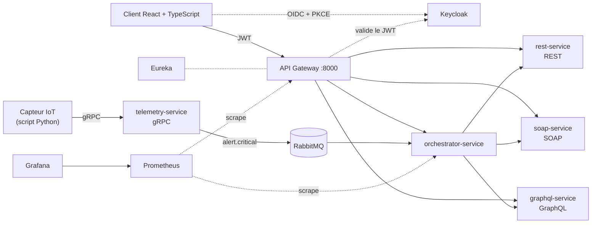
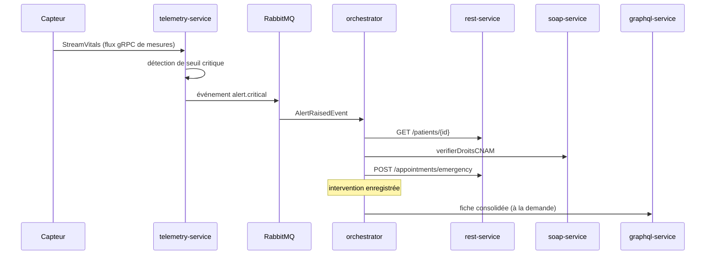

# Smart Healthcare : plateforme d'hôpital connecté


Plateforme de microservices pour un hôpital connecté et le suivi de santé à domicile.
Quatre services utilisant quatre protocoles différents (SOAP, REST, GraphQL, gRPC) sont
exposés derrière une API Gateway, sécurisés par Keycloak et orchestrés par des événements RabbitMQ.

Projet académique : Service Oriented Computing, 3e année cycle ingénieur.
Toutes les données (patients, actes, tarifs, seuils médicaux) sont **fictives**.

## Ce que démontre le projet

| Besoin | Réalisation |
|---|---|
| Interopérabilité de protocoles | SOAP (CNAM), REST (rendez-vous), GraphQL (tableau de bord), gRPC (télémétrie) |
| Point d'entrée unique | Spring Cloud Gateway, routage dynamique via Eureka |
| Sécurité centralisée | Keycloak : OAuth2 / OIDC, PKCE, JWT, RBAC (Patient, Médecin, Administrateur) |
| Découplage | RabbitMQ : exchange topic, file durable, Dead Letter Queue |
| Résilience | Resilience4j : circuit breaker, retry (lectures uniquement), timeouts |
| Observabilité | Prometheus + Grafana : métriques techniques et métier, règles d'alerte |
| Automatisation | GitHub Actions : tests, build des images Docker, publication GHCR, smoke test RBAC |
| Conteneurisation | Un Dockerfile multi-stage par service, Docker Compose pour toute la plateforme |

## Architecture



Chaque service possède sa propre base PostgreSQL (une base par service). Les services se
référencent entre eux par identifiant, jamais par jointure.

## Workflow d'une alerte médicale



Règles métier : une urgence est **toujours** réservée, même si les droits CNAM sont refusés ou
si le service SOAP est indisponible. Une crise déclenche **une seule** intervention (garde anti-doublon).
Après 3 échecs, le message part en Dead Letter Queue.

## Démarrage rapide

Prérequis : Docker Desktop, Python 3 (pour le capteur simulé).

```bash
docker compose --profile apps --profile monitoring up -d --build
```

Le premier démarrage prend quelques minutes. Les services s'enregistrent dans Eureka au fil de l'eau.

| Interface | URL |
|---|---|
| Client web | http://localhost:5173 |
| Eureka | http://localhost:8761 |
| RabbitMQ | http://localhost:15672 (admin / admin) |
| Keycloak | http://localhost:8080 (admin / admin) |
| Grafana | http://localhost:3000 (admin / admin) |
| Prometheus | http://localhost:9091 |

Comptes de démo (dev uniquement) :

| Utilisateur | Mot de passe | Rôle | Accès |
|---|---|---|---|
| `patient1` | `patient1` | Patient | Rendez-vous, ordonnances |
| `medecin1` | `medecin1` | Médecin | + tableau de bord, interventions, droits CNAM |
| `admin1` | `admin1` | Administrateur | Tout, y compris les endpoints d'administration |

## Scénario de démo (5 minutes)

1. Se connecter en `patient1` : seul l'onglet *Rendez-vous* est visible. Réserver un rendez-vous.
2. Se connecter en `medecin1` : filtrer le tableau de bord (Cardiologie, risque CRITICAL), ouvrir une fiche (une seule requête GraphQL), vérifier les droits CNAM des patients 1 (80 %) et 2 (refusés).
3. Laisser l'onglet *Interventions* ouvert et lancer le capteur en crise :
   ```bash
   cd sensor-simulator
   pip install grpcio grpcio-tools
   python -m grpc_tools.protoc -I ../docs/api --python_out=. --grpc_python_out=. telemetry.proto
   python sensor.py 1 crisis
   ```
   Une intervention apparaît seule : alerte, couverture CNAM, rendez-vous d'urgence.
4. Résilience : `docker compose stop soap-service`, relancer une crise sur le patient 2. L'urgence est quand même réservée, la couverture indique « indisponible », le circuit passe à l'état ouvert dans Grafana.
5. Découplage : `docker compose stop orchestrator-service`, lancer une crise, voir les messages s'accumuler dans RabbitMQ, redémarrer l'orchestrateur : ils sont traités, rien n'est perdu.

## Documentation des API

| Service | Protocole | Contrat |
|---|---|---|
| rest-service | REST | [docs/api/openapi.yaml](docs/api/openapi.yaml) |
| soap-service | SOAP | [docs/api/cnam.wsdl](docs/api/cnam.wsdl), [docs/api/cnam.xsd](docs/api/cnam.xsd) |
| graphql-service | GraphQL | [docs/api/schema.graphqls](docs/api/schema.graphqls) |
| telemetry-service | gRPC | [docs/api/telemetry.proto](docs/api/telemetry.proto) |

Les contrats sont régénérés avec `scripts/export-contracts.ps1`.

## Sécurité

- Authentification : Keycloak (Authorization Code + PKCE, client public).
- La Gateway valide la signature du JWT et applique le RBAC par route. Le client React masque les onglets selon le rôle, mais **la sécurité est appliquée à la Gateway** (403).
- En mode Docker, seuls la Gateway, Keycloak, le client, les interfaces d'administration et le port gRPC sont publiés : les services REST, SOAP et GraphQL ne sont pas joignables directement.

## Décisions d'architecture

- **Une base par service** : pas de couplage par les données.
- **Orchestration événementielle** : la télémétrie publie sans connaître l'orchestrateur. La file est durable et dotée d'une DLQ.
- **Pas de retry sur les écritures** : réessayer un `POST /emergency` dont la réponse s'est perdue créerait un doublon d'urgence.
- **Une urgence n'est jamais bloquée par l'assurance** : la couverture est notée sur la fiche, la réservation continue.
- **gRPC non exposé au navigateur** : il sert en interne (capteur, télémétrie, orchestrateur). Le web voit les données via REST et GraphQL.
- **Resilience4j en modules core** : appelés directement dans le code, indépendants de la version de Spring Boot.

## Limites connues et pistes d'amélioration

- Le garde anti-doublon de l'orchestrateur est en mémoire (à remplacer par Redis pour plusieurs instances).
- Pas de *transactional outbox* : si la base enregistre l'alerte mais que RabbitMQ est indisponible, l'événement est perdu.
- Les appels entre services ne portent pas de JWT (client credentials à ajouter).
- Un patient peut lire les données d'un autre patient : il faudrait lier le compte Keycloak à `patientId` par un claim.
- Les messages en DLQ ne sont pas rejoués automatiquement.
- gRPC en clair (TLS à ajouter) ; `ddl-auto: update` à remplacer par des migrations Flyway.
- Identifiants `admin/admin` et `directAccessGrantsEnabled` : réservés au développement.

## Développement local (sans conteneurs d'applications)

```bash
docker compose up -d                       # PostgreSQL (port 5433), RabbitMQ, Keycloak
# puis, dans chaque dossier de services/ : ./mvnw spring-boot:run
# ordre : eureka, rest, soap, graphql, orchestrator, telemetry, api-gateway ; puis client-web : npm run dev
```

## Structure

```
services/   eureka, rest, soap, graphql, telemetry, orchestrator, api-gateway
client-web/ React + TypeScript
sensor-simulator/ capteur IoT virtuel (Python)
infra/      init SQL, realm Keycloak, Prometheus, Grafana
docs/       contrats d'API et captures
scripts/    export des contrats
```